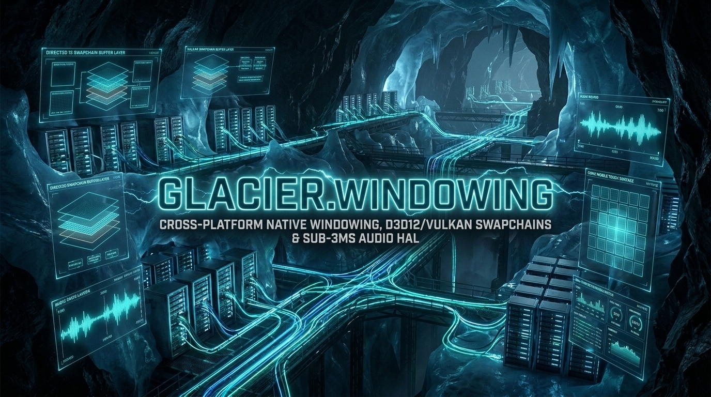

> [!IMPORTANT]
> **Repository Consolidated & Archived (2026-11):** This package has been consolidated into **[$(System.Collections.Hashtable.Target)](https://github.com/ian-cowley/Glacier.Desktop)** (namespace `Glacier.Desktop.Windowing`). Please reference the `Glacier.Desktop` NuGet package (v1.2.0+) for all future updates.

---


# Glacier.Windowing

**Pure C# .NET 10 Cross-Platform Windowing, Presentation Swapchain HAL, Low-Latency Audio, and Mobile Surface HAL**

Part of the **Glacier High-Performance .NET 10 Ecosystem** (Pillar 11).

[]()
[]()
[](LICENSE)
[](https://glaciersoftware.dev/)

---

## 1. Overview

**Glacier.Windowing** provides a unified, **100% pure C# .NET 10 (`IsAotCompatible = true`)** windowing, presentation swapchain, low-latency audio, and input abstraction driving native OS APIs directly via P/Invoke and COM vtables — with **zero third-party native wrapper DLLs** (`glfw3`, `SDL2`, `PortAudio`, or `OpenAL`):

- **OS Native Windowing (`Glacier.Windowing.Platform`)**:
  - **Windows (`Win32Window`)**: Direct `user32.dll` / `dwmapi.dll` / `gdi32.dll` interop with per-monitor V2 DPI awareness (`WM_DPICHANGED`), dark mode (`DWMWA_USE_IMMERSIVE_DARK_MODE`), creator-thread-safe window lifecycle, and `WM_INPUT` raw mouse/keyboard input (`InputEventType.MouseDelta` + client-coordinate button tracking).
  - **Linux (`X11Window` & `WaylandWindow`)**: Direct `libX11.so.6` P/Invoke and pure C# Wayland UNIX domain socket wire protocol.
  - **macOS (`CocoaWindow`)**: Objective-C runtime messaging via `libobjc.A.dylib` (`NSApplication`, `NSWindow`, `CAMetalLayer`).
  - **Mobile (`AndroidNativeWindow` & `IosUiWindow`)**: Android NDK `ANativeWindow` surface binding and iOS `UIWindow` / `CAMetalLayer` ProMotion touch dispatchers.
  - **Headless (`HeadlessWindow`)**: Deterministic virtual window (`NativeHandle == IntPtr.Zero`) automatically selected by `WindowFactory.CreateWindow` in non-graphical CI or server environments.
- **Presentation Swapchain HAL (`Glacier.Windowing.Swapchain`)**:
  - **`SoftwareSwapchain`**: 64-byte-aligned unmanaged RGBA8888 backbuffers with automatic Win32 DIB blitting when attached to a `Win32Window`.
  - **`D3D12Swapchain` (Windows)**: Probes DXGI 1.5 hardware tearing support (`IDXGIFactory5::CheckFeatureSupport`) and `ID3D12Device` availability, manages real Win32 waitable frame-latency kernel events, allocates 64-byte-aligned staging backbuffers, and blits SDR frames directly to the target `HWND`.
  - **`VulkanSwapchain`**: Dynamically loads `vulkan-1` / `libvulkan.so.1`, initializes a genuine `VkInstance`, and manages 64-byte-aligned host-visible staging image buffers.
  - **`MetalSwapchain` (macOS / iOS)**: Acquires the system `MTLDevice`, configures `CAMetalLayer`, and manages 64-byte-aligned drawable staging buffers.
  - Explicit platform gating: constructing an unsupported OS/driver backend throws `PlatformNotSupportedException` or `InvalidOperationException` (never fake magic pointers), while `SwapchainFactory.Create(..., SwapchainBackend.Auto)` falls back cleanly to `SoftwareSwapchain`.
- **Low-Latency Audio (`Glacier.Windowing.Audio`)**:
  - **`SpscAudioRingBuffer`**: Cache-line-isolated lock-free single-producer/single-consumer float PCM ring buffer.
  - **`WasapiAudioStream` / `WasapiAudioDevice` (Windows)**: Genuine COM `IMMDeviceEnumerator` -> `IMMDevice` -> `IAudioClient` (shared mode with automatic sample-rate conversion) -> `IAudioRenderClient` audio pump with MMCSS `"Pro Audio"` thread scheduling.
  - **`AlsaAudioDevice` (Linux / Android)**: Direct `libasound.so.2` (`snd_pcm_writei` + `snd_pcm_recover`) playback with master volume scaling.
  - **`CoreAudioDevice` (macOS / iOS)**: Native AOT `[UnmanagedCallersOnly]` `AURenderCallback` feeding Apple `AudioUnit` output from `SpscAudioRingBuffer`.
  - **`SimulatedAudioDevice`**: Deterministic in-memory audio device and stream returned by `AudioFactory` when no physical audio output endpoint exists (e.g., CI VMs).

---

## 2. Quickstart

```csharp
using Glacier.Windowing;
using Glacier.Windowing.Audio;
using Glacier.Windowing.Platform;

using var window = WindowFactory.CreateWindow(new WindowOptions
{
    Title = "Glacier Engine .NET 10",
    Width = 1280,
    Height = 720,
    DarkMode = true,
    EnableRawInput = true
});

using var swapchain = window.CreateSwapchain(new SwapchainDescription(
    Width: 1280,
    Height: 720,
    BufferCount: 3,
    EnableHdr: false,
    LowLatencyWaitable: true));

using var audio = AudioFactory.CreateDefaultDevice(sampleRate: 48000, channels: 2);

window.InputReceived += evt =>
{
    if (evt.Type == InputEventType.KeyDown)
    {
        Console.WriteLine($"Key pressed: {evt.KeyOrButton}");
    }
};

while (window.IsVisible)
{
    window.PollEvents();
    swapchain.Present(vsync: true);
}
```

---

## 3. Build, Test & Security Verification

```bash
dotnet build -c Release
dotnet test -c Release
python scripts/security_check.py Glacier.Windowing
```

---

## 4. License

MIT License. Copyright (c) 2026 Ian Cowley.

